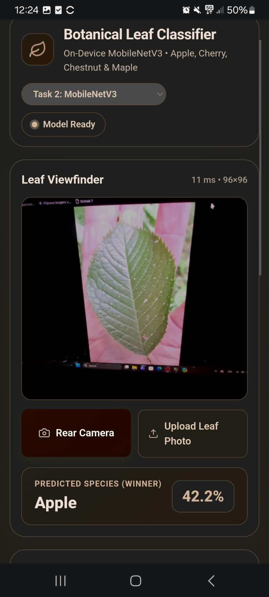
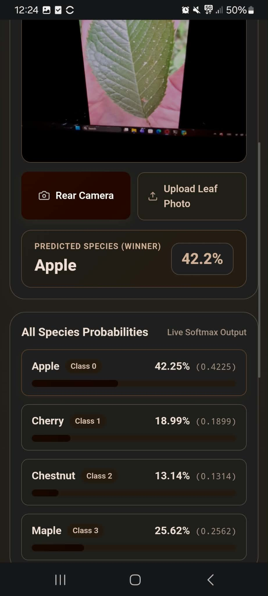
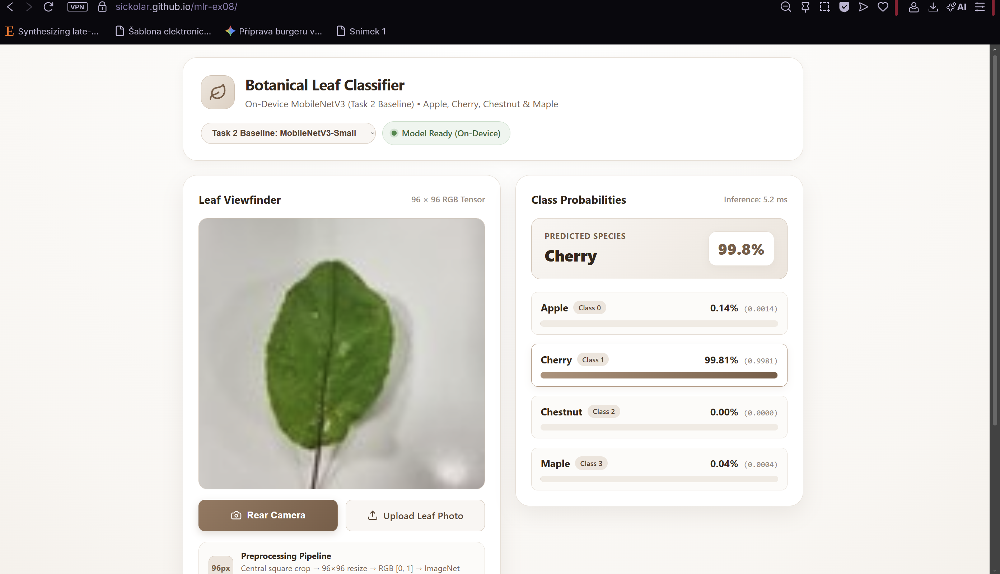
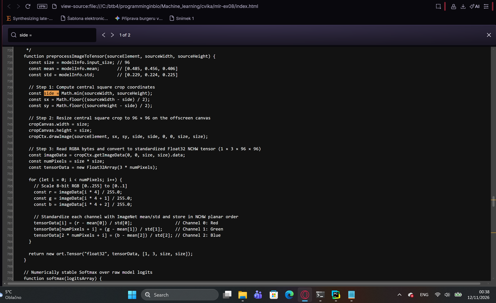
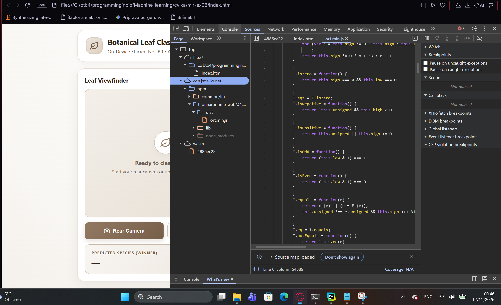

# TASK 2 
## 1 It runs on your phone: 

## 2 The same numbers as the notebook:

The values are the same as in the jason ->
{
 "apple": 0.001426716335117817,
 "cherry": 0.9981143474578857,
 "chestnut": 4.9615875468589365e-05,
 "maple": 0.00040932343108579516
}

## 3 The preprocessing matches your model
I have found the corresponding line in the .html file via screenshot bellow and it matches the mode_info.json. {"classes": ["apple", "cherry", "chestnut", "maple"], "input_size": 96, "mean": [0.485, 0.456, 0.406], "std": [0.229, 0.224, 0.225]}

## 4 Nothing leaves the phone:
cdn.jsdelivr.net is loaded to deliver packages from repositeries nmp and github and images are proccesed locally via webassembly (onnxruntime-web).

# TASK 4

5 different new models were tested and compared, Historical dataset was added for better classification (more training data). Also I choose optuna tuning because we used it last lessons and I thought it would be valuable here. Comparison of the model is done by ai agent in REPORT.md, best model (EfficientNet-B0), was choosen based on the comparison.

